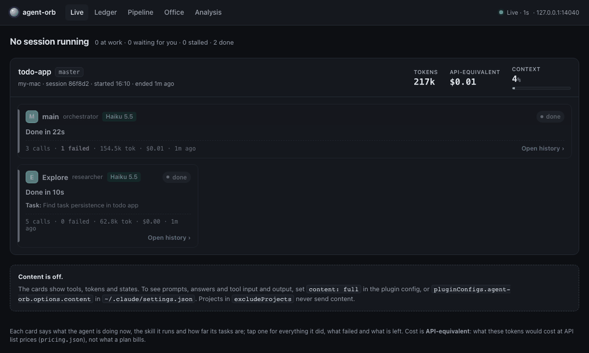
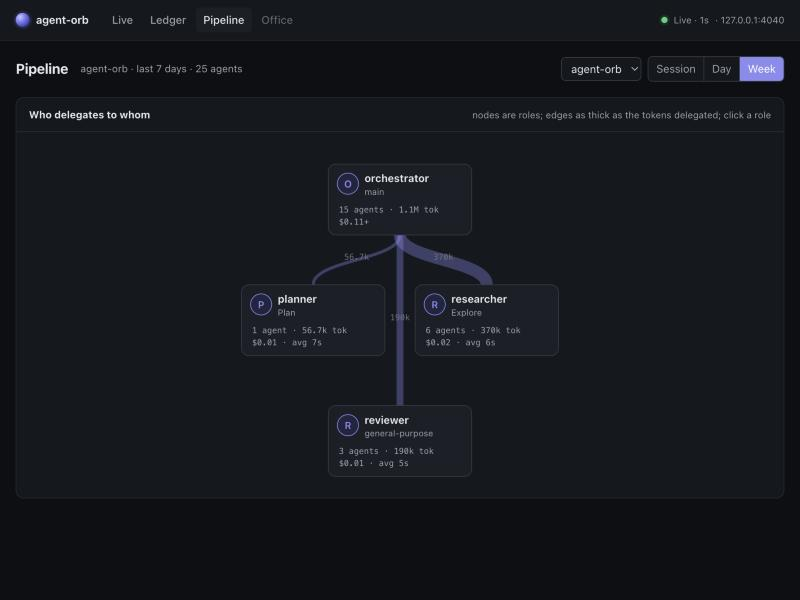
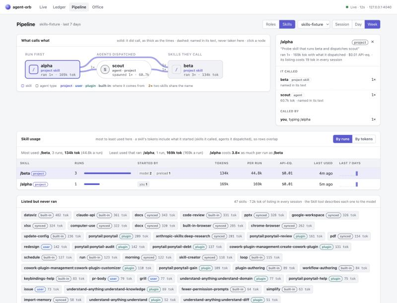
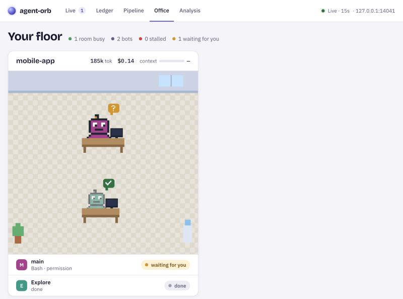

# agent-orb

See what your Claude Code agents are doing right now, what they cost, and how a project's skills and roles fit together. It runs on your own machine, it's free, and it never slows Claude Code down.

> agent-orb is an independent project. It is not affiliated with, endorsed by or supported by Anthropic. Claude and Claude Code are trademarks of Anthropic.



## What you get

- **Live.** A card per running agent: what it's doing in plain words, the skill it runs, its tokens. Tap a card for its tasks, what it did and what failed. Agents that stall or wait for a permission are flagged.
- **Alerts inside Claude Code.** The status line shows `👥 3 · 412k tok · ctx 61%`. It turns to `⚠ Explore: WebFetch 16m` with a notification when a tool or a silent agent passes the stall limit (15 minutes by default). `/orb` opens a small panel.
- **Ledger.** Tokens first, then the API-equivalent cost, by day, week or month, and by project, model and role.
- **Trends.** Is it getting cheaper? Cost per week or day, split by who spent it (the main session, agents on their own model, generic agents) or by model, per active day and per prompt. Every change to your setup is marked and compared with the days before it. Import Claude Code's own logs once and Trends starts with your past weeks.
- **Worth.** Is it paying off? Set your hourly rate and what your plan costs a month. Every merged PR is sized for you from its own diff (the lines changed times one plus the log of the files, leaving out lockfiles, images, build output and generated files; S, M, L or XL, with the hours and the cut points yours to change); tap another size and it becomes yours, and Back to Auto takes it back. Release merges are left out, and a PR gets only its share of the session that opened it. The Ledger puts those hours beside the attention the logs measured, and shows net hours, their value at your rate and the return on your plan. A losing month shows negative. Your numbers stay on your machine, and the PR list comes from your own `gh`, so it needs `gh` installed and logged in.
- **Model check.** An agent running on a pricier model than its agent file says, or than a ceiling you set for agents without one (Sonnet by default), shows as "pricier model" in Live and the status line, with one notification.
- **Changes you can measure.** At each session start the plugin fingerprints what shapes your agents: the project's agents, skills and CLAUDE.md, and your own `~/.claude/CLAUDE.md` and rules. Trends marks the day one of them changes. Only a path and a hash per file leave your machine, never the file.
- **A monthly goal.** A goal per project in API-equivalent dollars: the status line adds the month's percentage from 80% (`👥 3 · 1.2M tok · ctx 41% · Oct 81%`), warns past it (`⚠ mobile-app over its October goal: $2,540 of $2,500`) and sends one notification for each. Nothing is ever stopped.
- **Pipeline.** Who delegates to whom, by role, with edges as thick as the tokens they carry. You can correct a role in place.
- **Skill graph.** What each skill says it can call and what it actually called, how often each skill runs and how it was started, and what the skills you never use cost just by being listed.
- **Office.** A pixel-art room per project, with a bot per agent: typing, reading, thinking, delegating, waiting, stalled.
- **Analysis with Claude (optional).** Claude reads a project's week and reports where the tokens go and what to change. It uses your own API key, it never runs by itself, and a monthly cap stops it.

| Pipeline | Skill graph | Office |
|---|---|---|
|  |  |  |

## Requirements

- Docker with Compose v2 (Docker Desktop on macOS and Windows).
- Claude Code **2.1.299 or later**, in the terminal or the desktop app. Check yours with `claude --version`, and run `claude update` if it's older.
- About 200 MB of free memory for the server. It measured 153 MB after every page's queries ran 40 times over a session of 46,000 tool calls.
- Nothing paid. Only the optional Analysis spends money, on your Anthropic API credits, and only when you confirm a run.

## Install

**1. Start the server.**

```bash
git clone https://github.com/alfredo1996/agent-orb.git
cd agent-orb
cp deploy/.env.example deploy/.env
```

In `deploy/.env`, set `ORB_TOKEN` to a random value. `openssl rand -hex 24` makes a good one. Then:

```bash
docker compose -f deploy/docker-compose.yml up -d
```

The first start also builds the server image from the clone. The studio is then at <http://127.0.0.1:4040>, and it stays empty until a session runs.

**2. Install the plugin.** In Claude Code:

```
/plugin marketplace add alfredo1996/agent-orb
/plugin install agent-orb@agent-orb
```

From a shell, the same is `claude plugin marketplace add alfredo1996/agent-orb` and then `claude plugin install agent-orb@agent-orb`.

**3. Connect it.** Run `/plugin configure agent-orb@agent-orb` and paste your `ORB_TOKEN` into **Token**, then restart Claude Code. From a shell, `claude plugin configure agent-orb@agent-orb` shows the same settings. The server URL already points at `http://127.0.0.1:4040`.

**4. Start a session.** The main agent shows up in Live within 2 seconds, and its subagents appear under it as they're spawned.

## Import your history

Trends starts with the past, and the plugin can't have seen it. Claude Code keeps its own session logs on your machine, and one command reads them into your history. It reads usage and metadata only: tokens, models, agent types, timings and which skill ran. It never keeps your prompts, answers or tool output, whatever the content setting is.

```bash
docker compose -f deploy/docker-compose.yml run --rm -e ORB_HOST="$(scutil --get LocalHostName 2>/dev/null || hostname -s)" -v ~/.claude/projects:/import:ro orb-server import /import
```

`ORB_HOST` is the name the plugin files your sessions under: `scutil --get LocalHostName` on a Mac, because `hostname -s` follows the network's DNS and changes with it, and `hostname -s` elsewhere.

It prints a line per project and the totals. It's safe to run again: every event is keyed, so nothing is counted twice, and where the plugin recorded part of a session itself, its record wins for that stretch and the logs fill in before and after. Claude Code clears old logs by its `cleanupPeriodDays` setting, so import early.

## Settings

All of them live in the plugin's settings in Claude Code.

| Setting | Default | What it does |
|---|---|---|
| Server URL | `http://127.0.0.1:4040` | Where the plugin sends events |
| Token | empty | `ORB_TOKEN` from `deploy/.env` |
| Stall alert (minutes) | 15 | Flags a tool, or a silent agent mid-turn, after this long |
| Model ceiling | `sonnet` | Agents with no model of their own (general-purpose, workflow agents, `model: inherit`) are flagged above this: `haiku`, `sonnet`, `opus`, or `off` to turn that part off. An agent whose file has a `model:` is always held to that |
| Content | `off` | `off` sends metadata only. `full` also keeps prompts, answers, thinking where Claude Code shares it, and tool input and output |
| Never send content for | empty | Repo names, `owner/repo` or paths that stay metadata-only even with Content on `full` |

The server answers only requests addressed to `127.0.0.1`, `localhost` or `[::1]` (any port), so a web page can't reach it through DNS rebinding. If you serve it under another name, set `ORB_ALLOWED_HOSTS` in `deploy/.env` to a comma-separated list of names, for example `ORB_ALLOWED_HOSTS=orb.lan,nas.local`, and run `docker compose -f deploy/docker-compose.yml up -d` again. A plugin whose Server URL uses such a name needs it listed too.

## Privacy

- **Everything stays on your machine.** The server listens on 127.0.0.1 only. Events flow one way, from Claude Code to your server, and the server calls nothing out. There are two exceptions. The Analysis calls Anthropic's API when you confirm a run. And for Worth, the plugin runs your own `gh` at each session start to list the project's merged PRs, which asks GitHub with your login: each PR's number, merge time, size in lines, title and branch name reach your server, with two counts, the lines and files left once lockfiles, images, build output and generated files are set aside, never a file name, a body, an author or a diff. A project in **Never send content for** sends no titles or branch names. With no `gh`, or one that isn't logged in, nothing is sent.
- **Content is off by default.** With Content on `off`, the plugin sends metadata: tools, tokens, models, timings, and the short task description an agent is given. With `full`, text is masked for secrets and capped in length, and it lives in its own SQLite file next to the history.
- **It never slows Claude Code.** Hooks return at once. If the server is down, events wait in a local queue and arrive later. That was tested with the server stopped for 5 minutes: nothing was lost.

## Analysis with Claude (optional)

Add `ANTHROPIC_API_KEY` to `deploy/.env`, plus `ANTHROPIC_WORKSPACE_ID` if your key isn't scoped to a workspace, and run `docker compose -f deploy/docker-compose.yml up -d` again. Then, on the Analysis page:

1. Pick a project and a period: the last 7 days, the last 30 days, or one session. **Estimate** counts the input with the API's token counter and shows the most the run can cost.
2. Nothing is sent until you press **Confirm**.
3. A monthly cap, $20 by default and editable on the page, blocks runs past it. Every run is counted in the Ledger.

Opus 5.5 is the default model. You can pick Sonnet or Haiku for each run.

## Your data

- **Costs are API-equivalent:** what the tokens would cost at Anthropic's API prices. That isn't your subscription bill.
- **Query it yourself** with any SQLite client: `history.db` in a backup folder opens as it is, and PROJECT.md §6 lists its tables.
- **One Docker volume holds everything:** `orb-content-data`, with two SQLite files in it. `history.db` is the history, and `content.db` is the captured text and the analysis reports.

## Backups

`deploy/backup.sh run` copies both files into `~/agent-orb-backups/<date>/` and keeps the newest 7 folders: `history.db`, the history, and `content.db`, the captured text and the analysis reports.

Each is copied with SQLite's `VACUUM INTO` while the server runs, so nothing is stopped and nothing is missed. The script uses the image the stack's own container already runs and never pulls or builds one, so the stack must have been started once.

To run it every night at 03:30, opt in with `deploy/backup.sh install`. On macOS that adds a launchd agent: `install --dry-run` shows it first and `uninstall` removes it. On Linux it prints a crontab line for you to add.

Two things to know about the schedule on a Mac:

- The agent runs `backup.sh` from this checkout, so keep the checkout where it is. If you switch it to a branch that doesn't have the script, the nightly job fails.
- Docker Desktop has to be running at 03:30. If the Mac is asleep then, launchd runs the missed job when it wakes.

To restore, run `deploy/restore.sh ~/agent-orb-backups/<date>`. It asks first, stops the server, puts that day's two files back and starts the server again. A backup made by v0.2, a folder with a `neo4j.dump` in it, can't be restored by this version.

`ORB_BACKUP_DIR` and `ORB_BACKUP_KEEP` change where the copies go and how many are kept; the other settings are listed at the top of the script. On Linux the one-off container writes as its own user, so the backup folder may need to be writable for it.

## Known limits

- Thinking text arrives only from interactive sessions with thinking summaries on. Headless `claude -p` runs carry none, and they have no status line.
- Live state is held in memory, so restarting the server clears the live cards. The history, the Ledger and the reports keep everything.
- A session counts under the folder it started in.
- It's built for one person on one machine. The studio has no login, so keep it on 127.0.0.1.

## How it compares

- **[ccusage](https://github.com/ryoppippi/ccusage)** reads Claude Code's local logs and reports cost per day, month and session, plus a live view of the 5-hour usage block. It's a quick CLI with nothing to run. agent-orb keeps the history in a local database instead: cost per agent and role, who delegated to whom, skills, live alerts, and whether a change to your setup made it cheaper.
- **[Claude Code analytics](https://code.claude.com/docs/en/analytics)** is Anthropic's dashboard for Team and Enterprise plans: lines accepted, accept rate and merged PRs per person, and spend per person in the Console. It answers adoption questions for an organization. agent-orb looks inside your own sessions, agent by agent, on your machine.
- **[Phoenix](https://github.com/Arize-ai/phoenix)** is a general tracing and evaluation platform, and it can trace Claude Code turns through a plugin. If you want evals, datasets and experiments across many agents and frameworks, use Phoenix. agent-orb is built only for Claude Code: live agent state with alerts inside Claude Code, a project's skills and roles as a graph, and spend per project over weeks.

## Update and uninstall

```bash
git pull
docker compose -f deploy/docker-compose.yml up -d
claude plugin marketplace update agent-orb
claude plugin update agent-orb@agent-orb
```

**Coming from v0.2**, the history was in Neo4j and now it's in SQLite. Nothing is carried over: this version can't read the old graph, and can't restore a v0.2 backup. Run `docker compose -f deploy/docker-compose.yml up -d --remove-orphans` so the old `neo4j` container goes, import your history again (above) to fill the past, and keep the old backups by hand if you want them. The old graph's volume stays until you run `docker volume rm orb-neo4j-data`.

To remove it, run `claude plugin uninstall agent-orb@agent-orb` and then `docker compose -f deploy/docker-compose.yml down`. Add `-v` to the last command only if you also want to delete the data.

## Development

Requires Node 22.18 or later and pnpm. Docker is for running the stack; the tests start no container.

```bash
pnpm install
pnpm typecheck
pnpm test
pnpm soak
docker compose -f deploy/docker-compose.yml up -d --build
claude --plugin-dir packages/mod
```

`pnpm soak` is the memory check, part of CI: it calls every API 40 times over HTTP on a synthetic session of 46,000 tool calls, the size of the biggest history measured, and fails if the memory after the last round is more than 20% over the fifth's or over 256 MB, if a route doesn't answer 200, or if a route prepares a statement per request. To run it in Linux, on the server's base image:

```bash
docker run --rm --memory 1500m -v "$PWD":/repo:ro -w /repo node:22-alpine node --expose-gc packages/server/scripts/soak.ts
```

Add `--db <copy of history.db>` to run it on a real history instead (in Docker, mount the copy's folder too: the header of `soak.ts` has the command).

The design and every decision are in [PROJECT.md](PROJECT.md). [docs/verified.md](docs/verified.md) records the engine facts the plugin relies on, checked against a real Claude Code. The plan after v0.1 is in PROJECT.md §15. Issue numbers in the code and in PROJECT.md (#81, #114) refer to the development history before v0.3.0, which isn't public; this repository's own issues start after it.

## License

[MIT](LICENSE). agent-orb is not affiliated with Anthropic.
